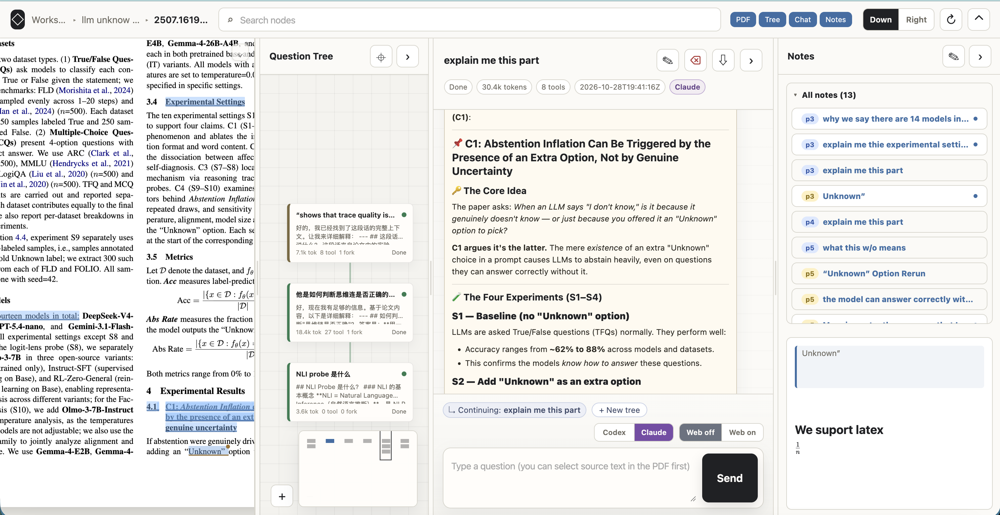

# PDF Tree QA

A FastAPI web app for reading PDFs and asking **tree-structured** questions about them.
You read a paper in a real PDF viewer (PDF.js), highlight text, and ask the LLM a question
straight from a selection. Each question is a node in a tree — fork a new question from any
earlier node, so your exploration branches instead of growing into one linear chat.

Backends are pluggable: the **Claude API** (default) or the **Codex CLI**.



## Features

- **Three-pane reader** — PDF │ question tree │ conversation, each pane collapsible to a rail
  and the PDF/chat widths resizable (layout persisted in `localStorage`).
- **Highlight and ask** — select text in the PDF to highlight it or ask a question straight
  from the selection. Highlights are stored as normalized page-fraction rects, so they survive
  reload and zoom. Saving a highlight never creates a node; asking does.
- **Branching question tree** — every Q&A turn is a node. Fork a new question from any earlier
  node and the full ancestor chain is stitched back into the prompt, so each call is
  self-contained without a literal chat-history API.
- **Workspaces** — a top-level project groups a set of PDFs and their shared files. Navigation
  is home (workspace cards) → workspace (PDF list) → reader.
- **Uploaded inbox** — drop local PDFs onto the dashboard's Uploaded block or use
  **Choose PDFs**. Open them directly, drag them onto workspace cards, or use
  **Move to...** on any PDF (also in the reader) to change workspace or return to Uploaded.
  Moves preserve highlights, questions, notes, and study history, reset the document's
  column to Uncategorized, and reject destination filename conflicts.
- **Notes** — a freeform Markdown note per node, plus workspace- and document-level notes.
- **Time tracking & Pomodoro** — automatic reading-time tracking per paper (rolled up per
  workspace) plus a built-in Pomodoro focus timer. See [Time tracking & Pomodoro](#time-tracking--pomodoro).
- **Live tool activity** — tool calls, command output, and web searches stream into the
  conversation pane as the backend runs.
- **Export** — pull any node (with its ancestor context) back out as text.

## Time tracking & Pomodoro

The app tracks how long you spend on each paper and totals it per workspace, and ships a
Pomodoro focus timer in the reader.

**Where you see it.** Each PDF card shows a ⏱ time-on-paper badge, and each workspace card on
the home dashboard shows the aggregated time across its papers. Badges are hidden at zero and
read as `45m` or `1h 20m`.

**How time is counted.** Two sources feed the same per-paper total, and a given minute is never
counted twice:

- **Passive reading** — accrues automatically while a paper's reader is open, but only while
  the tab is **visible**, the window is **focused**, and you've interacted (scroll / mouse /
  keys) recently. Switching tabs, leaving the window, or going idle pauses it; the idle grace
  window is trimmed back out, so time spent away from the screen doesn't count.
- **Pomodoro focus** — time inside a Pomodoro *focus* interval is logged against the current
  paper. Break time is **not** counted.

Only one clock runs at a time. Starting a focus session (manually or from the widget)
**engages** it: passive tracking switches fully off for the whole session — focus, breaks, and
pauses alike — so you never double-count, and nothing accrues during breaks. Stopping the
session hands timekeeping back to passive reading.

**Starting a focus session.** The reader's PDF toolbar has a ⏱ button that opens a quick-start
popover: pick a concentration length from the presets (15 / 25 / 45 / 50 min) or type a custom
one, optionally set the break length, and hit **Start focus**. The button lights up while a
session is running, and reopening the popover gives you quick **Pause / Resume / Stop**.

**The Pomodoro widget.** Starting a session opens a floating widget in the reader (bottom-right,
collapsible to a pill) that runs the classic cycle: focus → short break → long break every few
pomodoros. Durations, the long-break interval, auto-start of the next phase, and the
end-of-phase sound are all configurable from its settings gear and persist in `localStorage`.
The countdown is driven by a wall-clock end time, so it stays accurate even in a throttled
background tab, and each phase ends with a chime and a desktop notification (when you've granted
notification permission).

**Storage & portability.** Sessions live in a `study_sessions` table in the same SQLite database
and travel with a workspace when you export/import it. Deleting a paper or workspace removes its
sessions. Pomodoro settings are per-browser (`localStorage`), not stored server-side.

## Run

Dependencies are managed with [uv](https://docs.astral.sh/uv/) (`pyproject.toml` + `uv.lock`).
Requires Python 3.12+.

```bash
uv sync                 # install deps (enough for the Claude backend)
uv sync --extra codex   # also install sub-pool-client for the Codex backend
uv sync --extra tools   # pre-install libs the bash tool commonly uses (PyMuPDF, pdfplumber, …)
uv run python app.py    # serves on http://127.0.0.1:8080 (0.0.0.0 — reachable on your LAN)
```

The `tools` extra is optional convenience: it pre-installs PDF/image/web libraries the backend's
`bash` tool often reaches for (PyMuPDF, pdfplumber, pypdf, Pillow, requests, beautifulsoup4, lxml)
so runs don't pause to install them on the fly. The app never imports them itself.

## Import PDFs through the API

In Swagger (`/docs`), use `POST /api/batch-upload` and select PDFs in the `files`
picker. Uploads are binary multipart data, not Base64. Only the canonical `files`
field is shown; the legacy `file` alias remains accepted by existing clients.

```bash
curl 'http://127.0.0.1:8080/api/batch-upload' \
  -F 'files=@paper.pdf;type=application/pdf' \
  -F 'on_conflict=skip'
```

Repeat `-F 'files=@another.pdf;type=application/pdf'` for multiple PDFs. Optionally
send `workspace_id` or `workspace_name` and `category_id`. If neither workspace
field is provided, PDFs go into the dashboard's **Uploaded** inbox without creating
a workspace. Repeated uploads still honor `on_conflict` within that inbox.
Existing workspaces are not changed. Non-PDF filenames or missing PDF headers return
per-file errors. With authentication enabled, include the bearer token obtained from `/api/auth/login`.
The response uses HTTP 207 with per-file results.

`GET /api/documents?unassigned=true` lists only inbox documents (not question
attachments). `POST /api/documents/{id}/move` with JSON `{"workspace_id":"<id>"}`
moves a PDF; use `{"workspace_id":null}` to return it to Uploaded. A destination
filename conflict returns HTTP 409 without moving the document.

## Deploy with Docker Compose / Dokploy

The Docker image includes both the Claude and Codex backends, plus the `tools` extra.
It runs as a non-root user with a single Uvicorn worker on port **8080**, without
development reload. SQLite, uploaded PDFs, notes, run logs, and workspace files are
stored in the persistent `app-data` named volume mounted at `/app/instance`, which
is the app's normal `instance/` data directory. Local data from `instance/` is not
automatically migrated. Credentials and local files are excluded from the image's build
context.

### Dokploy

1. Create a **Docker Compose** service in your Dokploy project.
2. Select this Git repository and the branch containing these files. Set the Compose
   path to `docker-compose.yml` and use **Docker Compose**, not Docker Stack.
3. In **Environment**, set `ANTHROPIC_API_KEY` for the official Claude API, or
   `ANTHROPIC_BASE_URL` and `ANTHROPIC_AUTH_TOKEN` for a custom gateway. Dokploy writes
   these to `.env`; the Compose service loads them using `env_file`. You can also
   configure credentials per workspace instead. For Codex, set `SUB_POOL_URL` and
   `SUB_POOL_KEY`; the pool must be reachable from inside the container
   (`localhost` refers to the container, not the Dokploy host).
4. Deploy, then add a domain targeting service **`app`**, container port **`8080`**,
   with HTTPS enabled. The service joins Dokploy's existing external `dokploy-network`
   so its proxy can reach the app; no host port or hard-coded Traefik labels are required.
5. Configure backups for the `app-data` volume. Stop the service before taking a
   filesystem backup to keep SQLite and its associated files consistent. Do not delete
   the volume when redeploying.

**Protect access before exposing the domain.** This app has no built-in login, and its
AI backends can execute shell commands inside the container. Put it behind a VPN or an
authenticated reverse proxy and restrict access to trusted users. Do not mount the
Docker socket or sensitive host directories. Containerization does not provide
per-user isolation.

### Local Docker Compose

Create `.env` from `.env.example` and configure your credentials, then run:

```bash
docker compose up -d --build --wait
docker compose logs -f app
```

The default Compose file only exposes the internal port for Dokploy's proxy. To access
it locally without a proxy, first create the shared network if it does not already exist:

```bash
docker network create dokploy-network
docker compose build
docker compose run --rm --service-ports -p 127.0.0.1:8080:8080 app
```

Open `http://127.0.0.1:8080`. `docker compose down` preserves data;
`docker compose down -v` **deletes it**. The container always binds to port 8080;
the development-only `HOST`, `PORT`, and `APP_RELOAD` settings do not change its command.
To pin the Codex CLI version, set `build.args.CODEX_VERSION` in the Compose service;
otherwise each uncached image build installs the latest release.

## Configure

Copy `.env.example` to `.env` and fill in the backend you want (it loads automatically).

For the **Claude backend**, Claude credentials are all you need:

```bash
ANTHROPIC_BASE_URL=...       # custom gateway; or use ANTHROPIC_API_KEY for the official API
ANTHROPIC_AUTH_TOKEN=...
# CLAUDE_API_MODEL=claude-sonnet-4-6   # optional override
```

#### Per-workspace model & API settings

Each workspace has a **Model & API settings** block (on the workspace page) where you set your
own Base URL, auth type (Bearer token or API key), key, and model — overriding the env defaults
for that workspace's Claude-backend calls. Leave a field blank to fall back to the server default.
The key is stored in the local SQLite DB and is **never** returned to the browser (the UI only
shows whether one is configured).

Because the Claude backend talks to any **Anthropic-API-compatible** endpoint, this gives you
model flexibility: the official Anthropic API, a custom gateway, or a proxy such as **LiteLLM**
/ **one-api** that fronts other models (GPT, Gemini, Qwen, local Ollama, …) behind the Anthropic
request shape. Talking to those providers' *native* APIs is out of scope — route them through an
Anthropic-compatible proxy instead.

Common environment variables (see `.env.example` for the full list):

| Variable | Purpose |
|---|---|
| `ANTHROPIC_BASE_URL` / `ANTHROPIC_AUTH_TOKEN` / `ANTHROPIC_API_KEY` | Claude backend credentials |
| `CLAUDE_API_MODEL` | Claude model (default `claude-sonnet-4-6`) |
| `CLAUDE_API_TIMEOUT_SECONDS` / `CLAUDE_BASH_TIMEOUT_SECONDS` | Claude call / bash-tool timeouts |
| `ENABLE_WEB_SEARCH` | default web-search toggle (per-request override in the UI; default `false`) |
| `CODEX_MODEL` | Codex model (default `gpt-5.5`) |
| `SUB_POOL_URL` / `SUB_POOL_KEY` | credentials for the `sub-pool-client` that leases a Codex account per request |
| `PORT` / `HOST` | server bind address (default `8080` / `0.0.0.0`) |
| `APP_RELOAD` | set to `1` to enable uvicorn auto-reload during development |
| `QA_DATA_DIR` | override the directory holding the SQLite DB and workspace files (legacy `CODEX_QA_DATA_DIR` also supported) |

### Backends

- **Claude** (default) runs an agentic loop over the Anthropic SDK with a `bash` tool (full
  local exec in the workspace directory) and an optional `web_search` tool.
- **Codex** shells out to `codex exec --json`. Accounts are leased per request by the external
  `sub-pool-client` package; it is an optional extra (`[codex]`), and when it isn't installed
  the Codex backend fails gracefully and tells you to switch to Claude.

Pick the backend in the top bar before asking. Both always run with web search available
(per the toggle) and full local execution in the shared workspace directory.

## Run as a desktop app

For end users who shouldn't touch a terminal, the app can run inside a native window
(via [pywebview](https://pywebview.flowrl.com/)) and be frozen into a standalone
`.app` / `.exe` / Linux binary with [PyInstaller](https://pyinstaller.org/). The packaged app
targets the **Claude backend only** and stores its data in a per-OS application-data directory
(macOS `~/Library/Application Support/ReadPaper`, Windows `%APPDATA%\ReadPaper`, Linux
`~/.local/share/ReadPaper`) — not inside the app bundle. Users configure their own key and model
in each workspace's **Model & API settings** block (above), so no key is baked into the build.

```bash
uv sync --extra desktop        # install pywebview + pyinstaller
uv run python desktop.py       # dev: launch the window against a local server

# Build a standalone app (run on the OS you're targeting — PyInstaller does NOT cross-compile):
./packaging/build_macos.sh     # → dist/ReadPaper.app
./packaging/build_linux.sh     # → dist/ReadPaper/ReadPaper
./packaging/build_windows.ps1  # → dist\ReadPaper\ReadPaper.exe
```

Each platform's binary must be built on that platform (use a CI matrix to produce all three).

> **⚠️ Security.** The Claude backend's `bash` tool runs commands on the user's machine, and the
> Codex backend uses `--dangerously-bypass-approvals-and-sandbox`. Distributing this app gives
> whoever runs it an LLM with **local shell access** — fine for yourself or trusted users, but a
> real remote-code-execution exposure otherwise. Only hand out builds to people you trust, or gate
> the local-exec tools first.

## Data

Everything lives in one SQLite database at `instance/qa.sqlite` (override the directory
with `QA_DATA_DIR`, or the legacy `CODEX_QA_DATA_DIR`). Uploaded PDFs and attachments are stored under
`instance/workspace/uploads/`, and the rest of `instance/workspace/` is a scratch directory the
AI can read and write; files it changes are attributed back to the node that produced them and
surfaced in the reader's workspace-files tab. See
[docs/DATABASE_SCHEMA.md](docs/DATABASE_SCHEMA.md) for the schema and [explain.md](explain.md)
for a guided tour of the codebase.

## Tests

```bash
uv run pytest
```

> A separate, standalone CLI lives under [`cli/`](cli/) (treeflow) for browsing local Claude
> Code / Codex conversation history. It shares no code with this web app — see `cli/README.md`.
