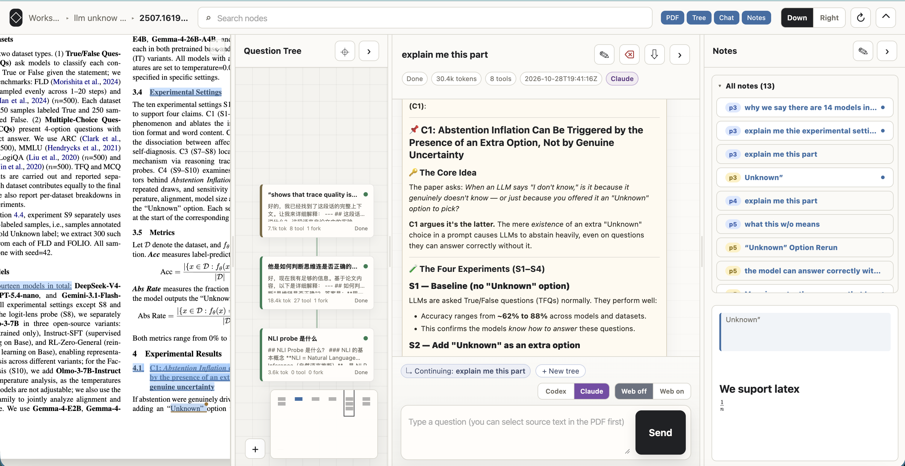

# PDF Tree QA

A FastAPI web app for reading PDFs and asking **tree-structured** questions about them.
You read a paper in a real PDF viewer (PDF.js), highlight text, and ask the LLM a question
straight from a selection. Each question is a node in a tree — fork a new question from any
earlier node, so your exploration branches instead of growing into one linear chat.

Backends are pluggable: the **Claude API** (default) or the **Codex CLI**.



## Features

- **Three-pane reader** — PDF │ question tree │ conversation, each pane collapsible to a rail
  and the PDF/chat widths resizable (layout persisted in `localStorage`).
- **Highlight and ask** — select text in the PDF to highlight it or ask a question straight
  from the selection. Highlights are stored as normalized page-fraction rects, so they survive
  reload and zoom. Saving a highlight never creates a node; asking does.
- **Branching question tree** — every Q&A turn is a node. Fork a new question from any earlier
  node and the full ancestor chain is stitched back into the prompt, so each call is
  self-contained without a literal chat-history API.
- **Workspaces** — a top-level project groups a set of PDFs and their shared files. Navigation
  is home (workspace cards) → workspace (PDF list) → reader.
- **Notes** — a freeform Markdown note per node, plus workspace- and document-level notes.
- **Live tool activity** — tool calls, command output, and web searches stream into the
  conversation pane as the backend runs.
- **Export** — pull any node (with its ancestor context) back out as text.

## Run

Dependencies are managed with [uv](https://docs.astral.sh/uv/) (`pyproject.toml` + `uv.lock`).
Requires Python 3.12+.

```bash
uv sync                 # install deps (enough for the Claude backend)
uv sync --extra codex   # also install sub-pool-client for the Codex backend
uv sync --extra tools   # pre-install libs the bash tool commonly uses (PyMuPDF, pdfplumber, …)
uv run python app.py    # serves on http://127.0.0.1:8080 (0.0.0.0 — reachable on your LAN)
```

The `tools` extra is optional convenience: it pre-installs PDF/image/web libraries the backend's
`bash` tool often reaches for (PyMuPDF, pdfplumber, pypdf, Pillow, requests, beautifulsoup4, lxml)
so runs don't pause to install them on the fly. The app never imports them itself.

## Configure

Copy `.env.example` to `.env` and fill in the backend you want (it loads automatically).

For the **Claude backend**, Claude credentials are all you need:

```bash
ANTHROPIC_BASE_URL=...       # custom gateway; or use ANTHROPIC_API_KEY for the official API
ANTHROPIC_AUTH_TOKEN=...
# CLAUDE_API_MODEL=claude-sonnet-4-6   # optional override
```

#### Per-workspace model & API settings

Each workspace has a **Model & API settings** block (on the workspace page) where you set your
own Base URL, auth type (Bearer token or API key), key, and model — overriding the env defaults
for that workspace's Claude-backend calls. Leave a field blank to fall back to the server default.
The key is stored in the local SQLite DB and is **never** returned to the browser (the UI only
shows whether one is configured).

Because the Claude backend talks to any **Anthropic-API-compatible** endpoint, this gives you
model flexibility: the official Anthropic API, a custom gateway, or a proxy such as **LiteLLM**
/ **one-api** that fronts other models (GPT, Gemini, Qwen, local Ollama, …) behind the Anthropic
request shape. Talking to those providers' *native* APIs is out of scope — route them through an
Anthropic-compatible proxy instead.

Common environment variables (see `.env.example` for the full list):

| Variable | Purpose |
|---|---|
| `ANTHROPIC_BASE_URL` / `ANTHROPIC_AUTH_TOKEN` / `ANTHROPIC_API_KEY` | Claude backend credentials |
| `CLAUDE_API_MODEL` | Claude model (default `claude-sonnet-4-6`) |
| `CLAUDE_API_TIMEOUT_SECONDS` / `CLAUDE_BASH_TIMEOUT_SECONDS` | Claude call / bash-tool timeouts |
| `ENABLE_WEB_SEARCH` | default web-search toggle (per-request override in the UI; default `false`) |
| `CODEX_MODEL` | Codex model (default `gpt-5.5`) |
| `SUB_POOL_URL` / `SUB_POOL_KEY` | credentials for the `sub-pool-client` that leases a Codex account per request |
| `PORT` / `HOST` | server bind address (default `8080` / `0.0.0.0`) |
| `APP_RELOAD` | set to `1` to enable uvicorn auto-reload during development |
| `CODEX_QA_DATA_DIR` | override the directory holding the SQLite DB and workspace files |

### Backends

- **Claude** (default) runs an agentic loop over the Anthropic SDK with a `bash` tool (full
  local exec in the workspace directory) and an optional `web_search` tool.
- **Codex** shells out to `codex exec --json`. Accounts are leased per request by the external
  `sub-pool-client` package; it is an optional extra (`[codex]`), and when it isn't installed
  the Codex backend fails gracefully and tells you to switch to Claude.

Pick the backend in the top bar before asking. Both always run with web search available
(per the toggle) and full local execution in the shared workspace directory.

## Run as a desktop app

For end users who shouldn't touch a terminal, the app can run inside a native window
(via [pywebview](https://pywebview.flowrl.com/)) and be frozen into a standalone
`.app` / `.exe` / Linux binary with [PyInstaller](https://pyinstaller.org/). The packaged app
targets the **Claude backend only** and stores its data in a per-OS application-data directory
(macOS `~/Library/Application Support/ReadPaper`, Windows `%APPDATA%\ReadPaper`, Linux
`~/.local/share/ReadPaper`) — not inside the app bundle. Users configure their own key and model
in each workspace's **Model & API settings** block (above), so no key is baked into the build.

```bash
uv sync --extra desktop        # install pywebview + pyinstaller
uv run python desktop.py       # dev: launch the window against a local server

# Build a standalone app (run on the OS you're targeting — PyInstaller does NOT cross-compile):
./packaging/build_macos.sh     # → dist/ReadPaper.app
./packaging/build_linux.sh     # → dist/ReadPaper/ReadPaper
./packaging/build_windows.ps1  # → dist\ReadPaper\ReadPaper.exe
```

Each platform's binary must be built on that platform (use a CI matrix to produce all three).

> **⚠️ Security.** The Claude backend's `bash` tool runs commands on the user's machine, and the
> Codex backend uses `--dangerously-bypass-approvals-and-sandbox`. Distributing this app gives
> whoever runs it an LLM with **local shell access** — fine for yourself or trusted users, but a
> real remote-code-execution exposure otherwise. Only hand out builds to people you trust, or gate
> the local-exec tools first.

## Data

Everything lives in one SQLite database at `instance/codex_qa.sqlite` (override the directory
with `CODEX_QA_DATA_DIR`). Uploaded PDFs and attachments are stored under
`instance/workspace/uploads/`, and the rest of `instance/workspace/` is a scratch directory the
AI can read and write; files it changes are attributed back to the node that produced them and
surfaced in the reader's workspace-files tab. See
[docs/DATABASE_SCHEMA.md](docs/DATABASE_SCHEMA.md) for the schema and [explain.md](explain.md)
for a guided tour of the codebase.

## Tests

```bash
uv run pytest
```

> A separate, standalone CLI lives under [`cli/`](cli/) (treeflow) for browsing local Claude
> Code / Codex conversation history. It shares no code with this web app — see `cli/README.md`.
